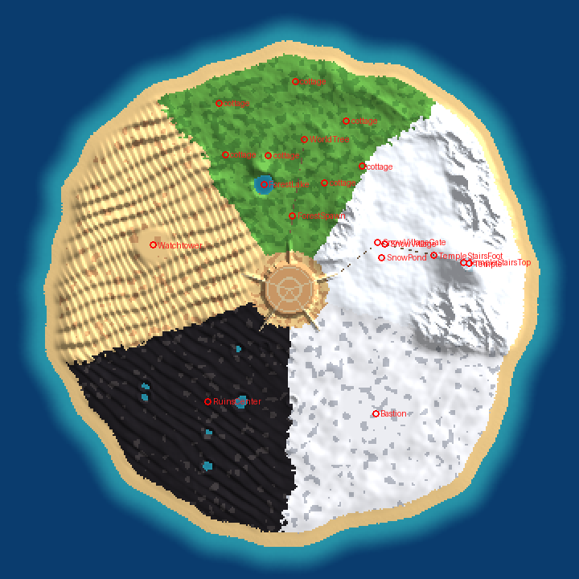

# Island Map Generator (Roblox Studio)

Builds a huge island map in Roblox Studio with one command: a desert capital
in the middle, five large regions around it, a beach all the way around, and
the sea as the edge of the world. Terrain, buildings, trees, lights,
particles and per-region sky/weather are all generated.



*Top-down layout preview. The images in `docs/previews` come from a rough
software renderer used for testing; they show layout and shapes, not
Roblox's real lighting and materials.*

Seen from above, the regions go clockwise around the capital in this order:
Wildwood → Vale → Hollow → Remnant → Dunes.

| Region | Inspired by | What's there |
| --- | --- | --- |
| **Solkhar, Citadel of the Sun Throne** (center) | Alubarna | Walled city on a sandstone mesa: terraced royal palace with a great dome and four towers, sun-clock spire, ~250 flat-roofed houses with domes and awnings, five fountain plazas with market stalls, palm-lined avenues and five grand gates whose causeways run down to every region. |
| **Eloria Wildwood** (players spawn here) | Elysia | Lush forest with groves and sunny clearings, blossom trees shedding petals, rare giant mossy trees, the colossal **Elderheart** world tree with spirit lanterns, Mirror Lake with a waterfall and dock, elven ruins, glowing mushrooms, and just 7 cottages hidden among the trees. Arrival stone circle with glowing runes and signposts. |
| **Shirayuki Vale** | Demon Slayer winter mountains | Deep snowy pine forest covering most of the region, a very small Japanese village (6 minka houses, well, shrine, lanterns, frozen pond, torii), Jizo statues along the trail, a lone charcoal-burner's hut, and **Ryuudou Temple** high on a mountain far from the village: a long stone stairway with torii and lanterns, a two-storey gate, the main hall, a five-storey pagoda, a bell pavilion and a sacred cedar. |
| **The Hollow Expanse** | Hueco Mundo | White-sand desert under eternal night with a giant crescent moon, the **Pale Bastion** (colossal white dome ringed by needle towers), crystal-white dead trees, leaning pale spires and arches, giant half-buried skeletons and glowing fissures. |
| **Ashen Remnant** | — | Black-sand dunes with 34 broken, tilted and toppled skyscrapers, no streets, ~120 wrecked cars, bent lamps, charred trees, fallen billboards, flooded craters and smouldering fires. |
| **Sea of Whispering Dunes** | Augria Dunes | Towering golden dunes with the **Starwarden Watchtower** in the exact middle: seven tiers with glowing star windows, an observatory with an armillary sphere around a captive star, and a pillar of light visible from anywhere on the island (teleport circles carry players to the top). Hoodoos, sandstone arches, a buried colossus, a leviathan skeleton and lost caravans. |
| **The Endless Shore** | — | Sand beach around the whole island, decorated per region (palms, driftwood, snowy rocks, ice, bones, wrecks), a lighthouse, a shipwreck and an invisible wall out at sea. |

None of these are copies. Every building, layout and name is an original
design that only borrows the feel of the places it was inspired by.

## How to use it

1. Download **[`dist/IslandMapGenerator.rbxmx`](dist/IslandMapGenerator.rbxmx)**.
2. Open your place in Roblox Studio (edit mode, **not** while playtesting).
3. In the Explorer, right-click **ServerStorage → Insert from File…** and pick the `.rbxmx`.
4. Open **View → Command Bar** and run:

   ```lua
   require(game.ServerStorage.IslandMapGenerator).Build()
   ```

5. Watch the **Output** window. Terrain takes the longest (progress is printed
   every 5%). Wait for `[IslandMap] Done`. Expect a few minutes.
6. Press **Play**. Players start in the Wildwood stone circle; walk up the
   causeway to the capital.

The generator also:
- removes the default `Baseplate` and `SpawnLocation` (they'd sit inside the mesa),
- sets up Future lighting, sky, atmosphere, bloom, colour grading and clouds,
- copies `IslandLayout` into ReplicatedStorage and the `IslandAtmosphere`
  LocalScript into StarterPlayerScripts (per-region time of day, fog, weather,
  the Hollow's night sky and a fading region-name banner),
- turns on `Workspace.StreamingEnabled` (important for a map this big).

If the Output warns that it couldn't set `Lighting.Technology` or
`StreamingEnabled`, set them by hand: **Lighting → Technology = Future** and
**Workspace → StreamingEnabled = true**.

### Rebuilding parts of the map

```lua
local Gen = require(game.ServerStorage.IslandMapGenerator)
Gen.Build({ "Snow" })               -- rebuild only Shirayuki Vale (keeps terrain)
Gen.Build({ "Hub", "Atmosphere" })  -- several at once
Gen.Clear()                         -- delete the generated map and all terrain
```

Step names: `Terrain`, `Hub`, `Forest`, `Snow`, `Hollow`, `Dunes`, `Ruins`, `Coast`, `Atmosphere`.

If you edit the scripts and the command bar still seems to run the old
version, save and reopen the place so `require` loads your changes.

## Settings

`IslandMapGenerator/Config` (edit the ModuleScript in ServerStorage before running):

| Setting | Default | Meaning |
| --- | --- | --- |
| `PLAYER_START` | `"Forest"` | `"Forest"` = spawn in the Wildwood arrival circle, `"Hub"` = spawn in the capital in front of the palace. Both spawn pads are built; this picks the enabled one. |
| `FOLIAGE_DENSITY` | `1` | Multiplies trees, bushes and beach decor. `1` gives about 123k parts in total; `0.5` roughly halves the forests. |
| `Build` | all `true` | Turn steps on or off. |
| `STREAMING` | `true` | Enable instance streaming. |
| `CLEAR_EXISTING` | `true` | Clear old terrain and generated folders before building. |

`IslandMapGenerator/IslandLayout` holds the map shape:

- `ISLAND_RADIUS = 6000`: the island is about **12,000 studs across**, with
  sea out to a world border at ~7,400 studs from the center. Everything
  (landmarks, sea, border) scales from this one number.
- `SEED`: change it for a differently shaped island and different scatter.
- Region names and subtitles (`ZoneInfo`), the order of regions, the capital size, etc.

**About "maximum size":** Roblox has no fixed map-size limit, but physics and
rendering get jittery far from the origin, and build time and part count grow
with the island's area. 12,000 studs is already enormous (it takes a few
minutes to run across). You can raise `ISLAND_RADIUS` to about 8000 if you
want it even bigger. Expect roughly 1.8× the parts and build time, and
consider lowering `FOLIAGE_DENSITY`.

### Region atmosphere

`StarterPlayerScripts/IslandAtmosphere` has a `PROFILES` table per region
(time of day, brightness, fog colour, colour grading, clouds, weather) and an
`AMBIENT_SOUNDS` table. Paste a sound asset id per region there for ambience.

## Repository layout

```
src/IslandMapGenerator/        the generator (Rojo-compatible: default.project.json)
  init.luau                    Build() / Clear()
  Config.luau, IslandLayout.luau
  Landscape.luau               height + materials for every point of the island
  TerrainWriter.luau           writes the terrain voxels
  Props.luau                   trees, palms, lanterns, cars, bones, ...
  Atmosphere.luau              lighting setup + installs the client script
  Zones/*.luau                 one builder per region
  Client/IslandAtmosphere.client.luau
dist/IslandMapGenerator.rbxmx  ready-to-insert model (built from src)
tools/                         test harness (Roblox API mock), previews, rbxmx builder
docs/previews/                 software-rendered previews
```

### Developing

The generator can run outside Studio against a Roblox API mock using the
standalone [Luau](https://github.com/luau-lang/luau/releases) interpreter:

```sh
python3 tools/bundle.py tools/test_driver.luau /tmp/test.luau && luau /tmp/test.luau   # full build + stats
python3 tools/preview.py ./luau docs/previews/island_map.png 360                        # top-down map
python3 tools/render.py ./luau /tmp/renders                                             # 3D preview renders
python3 tools/build_rbxmx.py                                                            # rebuild dist/*.rbxmx
```
