# Island Map Generator (Roblox Studio)

Builds a huge island map in Roblox Studio with one command: a desert capital
in the middle, five large regions around it, a beach all the way around, and
the sea as the edge of the world. Terrain, buildings, trees, water, lights,
particles and per-region sky/weather are all generated. The buildings and
trees are detailed Blender meshes (`assets/IslandAssets.fbx`).

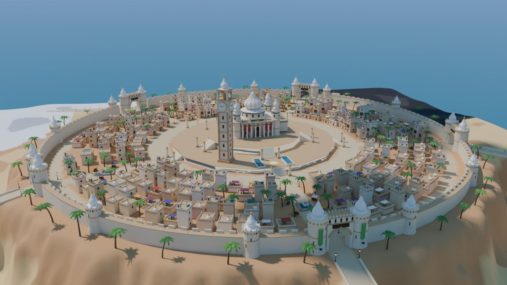

*The previews are rendered in Blender from the generator's real output (same
meshes, positions and terrain heights). In Studio you get Roblox's own
lighting, materials, water and atmosphere instead.*


Seen from above, the regions go clockwise around the capital in this order:
Wildwood → Vale → Hollow → Remnant → Dunes.

| Region | Inspired by | What's there |
| --- | --- | --- |
| **Solkhar, Citadel of the Sun Throne** (center) | Alubarna | Walled city on a sandstone mesa: terraced royal palace with onion domes, minarets and a colonnade, two reflecting pools, a sun-clock spire, ~260 flat-roofed houses with rooftop gardens and awnings, five fountain plazas with market stalls, palm-lined avenues and five grand gates whose causeways run down to every region. |
| **Eloria Wildwood** (players spawn here) | Elysia | Lush forest with groves and sunny clearings, blossom trees shedding petals, rare giant mossy trees, the colossal **Elderheart** world tree with spirit lights, Mirror Lake fed by a waterfall that pours off a cliff-top spring, a dock, elven ruins, glowing mushrooms, and just 7 timber-framed cottages hidden among the trees. Arrival stone circle with glowing runes and signposts. |
| **Shirayuki Vale** | Demon Slayer winter mountains | Deep snowy pine forest covering most of the region, a very small Japanese village (6 minka farmhouses, well, shrine, lanterns, a pond frozen except for its middle, torii), Jizo statues along the trail, a lone charcoal-burner's hut, and **Ryuudou Temple** high on a mountain far from the village: a long stone stairway with torii and lanterns, a two-storey gate, the main hall, a five-storey pagoda, a bell pavilion and a sacred cedar. |
| **The Hollow Expanse** | Hueco Mundo | White-sand desert under eternal night with a giant crescent moon, the **Pale Bastion** (colossal ribbed white dome ringed by needle towers), crystal-white dead trees, leaning pale spires and arches, giant half-buried skeletons and glowing fissures. |
| **Ashen Remnant** | — | Black-sand dunes with 34 broken, tilted and toppled skyscrapers (glass towers, offices with sheared-off tops, gutted concrete frames), no streets, ~120 burnt-out cars and vans, bent lamps, charred trees, fallen billboards, flooded craters and smouldering fires. |
| **Sea of Whispering Dunes** | Augria Dunes | Towering golden dunes with the **Pleiades-style watchtower** in the exact middle (1,150 studs tall, see below), wreathed in a sea of clouds; teleport circles carry players from the entrance to the crown. Hoodoos, sandstone arches, a colossal stone head and hand buried in the sand, a leviathan skeleton and lost caravans. |
| **Sky** | — | About 100 puffy clouds: a sea of clouds around the watchtower just below its crown, high clouds drifting over the island, mist on the temple mountain and in the snowy valleys, morning mist over Mirror Lake and dark ash clouds over the ruins. The Hollow's night sky stays clear. |
| **The Endless Shore** | — | Sand beach around the whole island, decorated per region (palms, driftwood, snowy rocks, ice, bones, wrecks), a striped lighthouse with a keeper's cottage, a shipwreck in the surf and an invisible wall out at sea. |

Apart from the watchtower, which you asked to resemble the original, none of these are copies. Every building, layout and name is an original
design that only borrows the feel of the places it was inspired by.

## How to use it

1. Download **[`dist/IslandMapGenerator.rbxmx`](dist/IslandMapGenerator.rbxmx)**
   and **[`assets/IslandAssets.fbx`](assets/IslandAssets.fbx)**.
2. Open your place in Roblox Studio (edit mode, **not** while playtesting).
3. **Import the meshes:** **File → Import** (older Studio: **Home → Import 3D**),
   pick `IslandAssets.fbx`, keep the default settings and click **Import**:
   *Scale Unit* stays **Studs** and *Merge Meshes* stays off. You can also
   tick *Anchored*. The models arrive at 1/10 of their real size (the
   generator scales them up). You get a model named **`IslandAssets`** in
   Workspace; keep that name. (You can skip this step: the generator then
   builds everything from plain parts, which works but looks much simpler.)
4. In the Explorer, right-click **ServerStorage → Insert from File…** and pick
   `IslandMapGenerator.rbxmx`.
5. Open the **Command Bar** (**Ctrl+9**, or **Window → Script → Command Bar**;
   older Studio: **View → Command Bar**) and run:

   ```lua
   require(game.ServerStorage.IslandMapGenerator).Build()
   ```

6. Watch the **Output** window (**Window → Output**; older Studio: **View → Output**). It says `Using 50 detailed models from the
   imported IslandAssets model` when it found the meshes. Terrain takes the
   longest (progress is printed every 5%). Wait for `[IslandMap] Done`.
   Expect a few minutes.
7. Press **Play**. Players start in the Wildwood stone circle; walk up the
   causeway to the capital.

The generator also:
- moves the imported `IslandAssets` model into ServerStorage, where it stays
  as the source for every rebuild,
- removes the default `Baseplate` and `SpawnLocation` (they'd sit inside the mesa),
- sets up Future lighting, sky, atmosphere, bloom, colour grading and clouds,
- copies `IslandLayout` into ReplicatedStorage and the `IslandAtmosphere`
  LocalScript into StarterPlayerScripts (per-region time of day, fog, weather,
  the Hollow's night sky and a fading region-name banner),
- turns on `Workspace.StreamingEnabled` (important for a map this big).

If the Output warns that it couldn't set `Lighting.Technology` or
`StreamingEnabled`, set them by hand: **Lighting → Technology = Future** and
**Workspace → StreamingEnabled = true**.

### Rebuilding parts of the map

```lua
local Gen = require(game.ServerStorage.IslandMapGenerator)
Gen.Build({ "Snow" })               -- rebuild only Shirayuki Vale (keeps terrain)
Gen.Build({ "Hub", "Atmosphere" })  -- several at once
Gen.Clear()                         -- delete the generated map and all terrain
```

Step names: `Terrain`, `Hub`, `Forest`, `Snow`, `Hollow`, `Dunes`, `Ruins`, `Coast`, `Sky`, `Atmosphere`.
The fountain, pool and waterfall water is part of the `Terrain` step.

If you edit the scripts and the command bar still seems to run the old
version, save and reopen the place so `require` loads your changes.

## Detailed buildings and trees (Blender meshes)

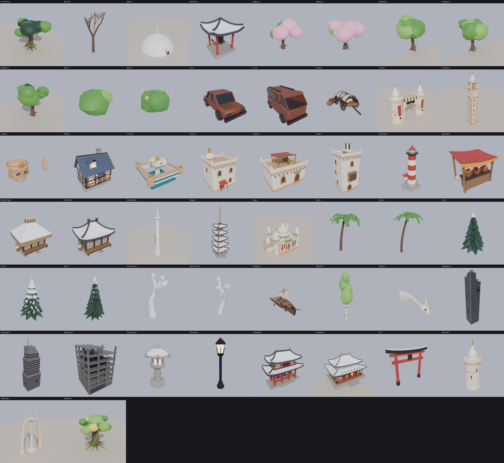

`assets/IslandAssets.fbx` holds 50 models (about 185k triangles in all,
every mesh under 10k triangles), all modelled in Blender by the scripts in
`tools/blender/`:

| Region | Meshes |
| --- | --- |
| Capital | palace, sun-clock spire, city gate, wall tower, 3 house types, fountain, market stall, 2 palms, street lamp |
| Wildwood | 3 broadleaf trees, 2 blossom trees, silver birch, ancient mossy tree, the world tree, 2 bushes, cottage |
| Vale | 3 snowy pines, bare tree, torii, stone lantern, thatched and tiled minka, temple hall, temple gate, pagoda, bell pavilion |
| Hollow | the Pale Bastion, needle tower, 2 quartz trees, giant skeleton |
| Remnant | glass tower, office tower, gutted frame, sedan, van |
| Dunes | the watchtower, buried colossus, caravan |
| Shore | lighthouse with cottage, shipwreck |

How the generator uses them:

- Every mesh is named `<Asset>__<Style>`, for example `Palace__Marble`. The
  style picks the Roblox colour and material (marble, sandstone, wood planks,
  roof tiles, snow, neon glow, …). Leaves, cloth and glow pieces don't
  collide; large pieces use precise collisions so players can walk through
  gates and up stairs.
- Three tiny marker meshes per asset (`__Origin`, `__Up`, `__Front`) tell the
  generator where each model's ground point, up and front are and how big it
  really is. It doesn't matter which axis or unit settings the importer used.
  If the models come in tiny, huge or lying on their side, the generator
  still places them correctly.
- Trees, palms and houses get random colour variations, scales and
  rotations, so the same few meshes don't look repeated. Lights, fire,
  chimney smoke, falling petals and other effects are added on top.
- Anything that has no mesh (for example if you deleted one from the
  imported model) is built from parts as before.
- With the meshes the full map is about **40k parts** (34k of them
  MeshParts that share about 250 meshes). Without them it's about 125k parts.

**Changing a model:** open `assets/IslandAssets.blend` in Blender, or edit
`tools/blender/assets_*.py` and rebuild the library:

```sh
pip install bpy   # Blender as a Python module
python tools/blender/build_assets.py assets --render /tmp/asset_renders
```

Then in Studio delete the old `IslandAssets` from ServerStorage, import the
new FBX and run `Build()` again. To export only some models, use
`--only hub,snow` or `--assets Palace,Torii`.

## Real water

All water on the map is Roblox terrain water: swimmable, with waves and
reflections. The sea, Mirror Lake, the village pond and the flooded craters
in the ruins were already terrain water. These are now real water too:

- **Five fountains** in the capital's plazas: a 24 × 24 basin and a raised
  bowl, with water jets on top.
- **Two reflecting pools** flanking the approach to the palace.
- **The Wildwood waterfall:** a spring pool on a cliff-top plateau, a stream
  running to the edge, and a curtain of water falling about 85 studs into
  Mirror Lake, with spray and mist particles at the lip and the foot.
- **The village pond** is frozen at the edges, with open water in the middle.

Terrain water comes in 4-stud voxels, so every basin, pool and channel is
lined up with that grid and its stone rim fits the water exactly.

## Previews

| | |
| --- | --- |
| 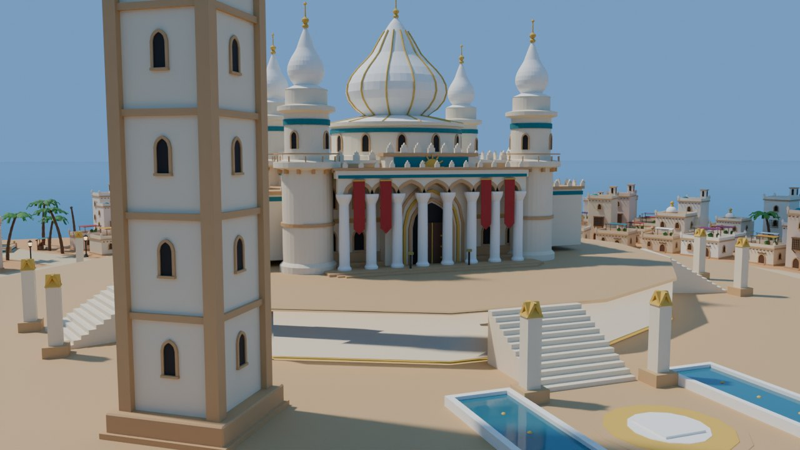 | 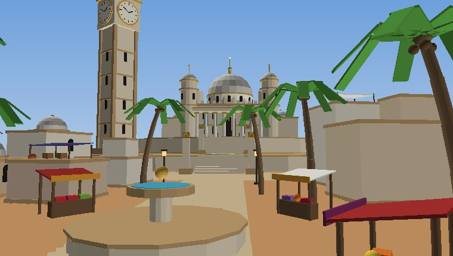 |
| 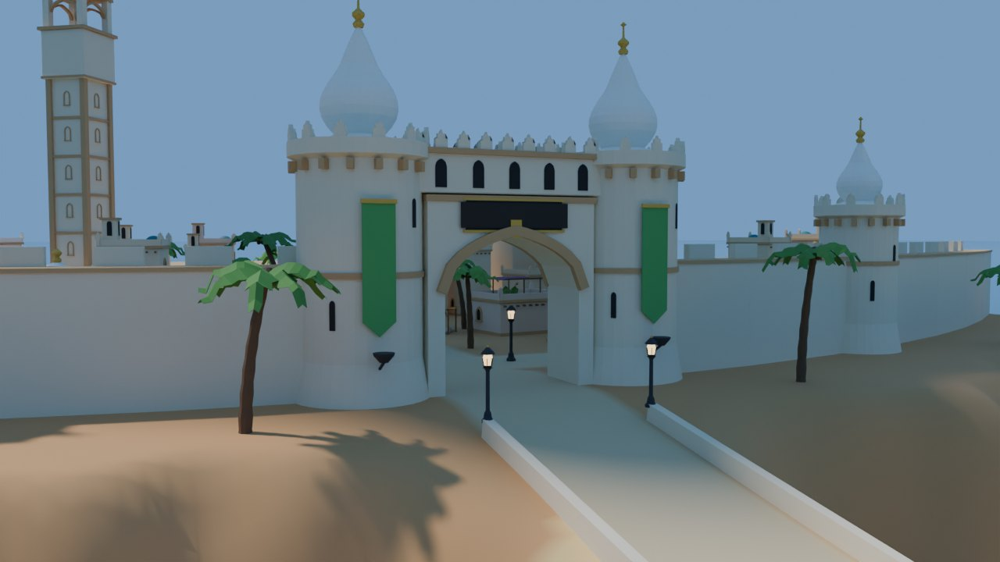 | 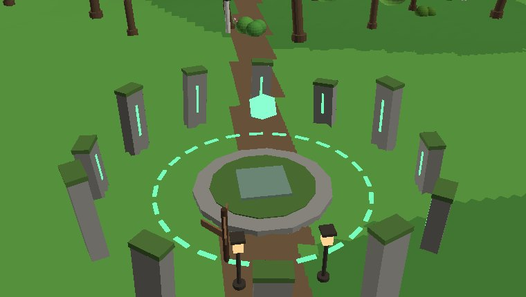 |
| 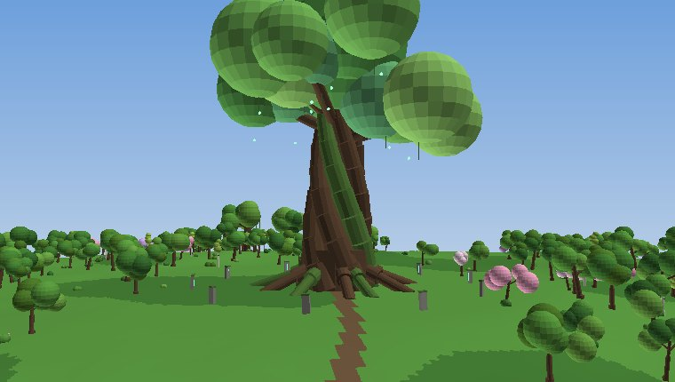 | 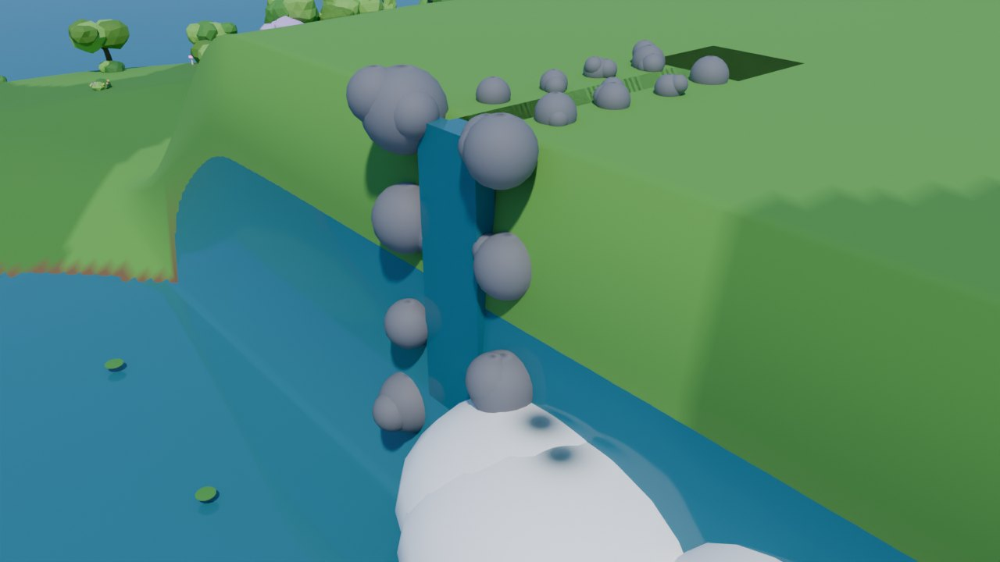 |
| 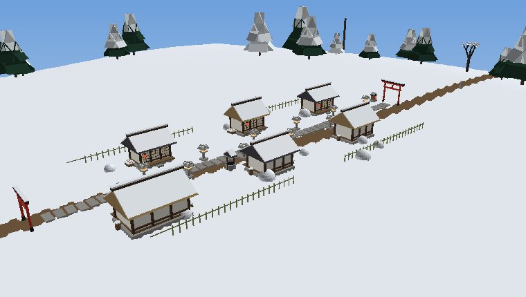 | 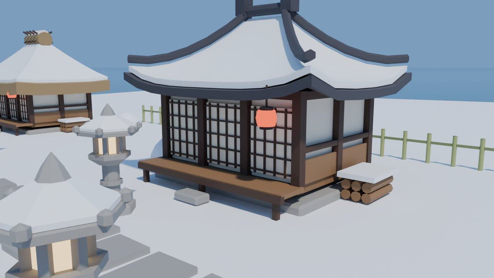 |
| 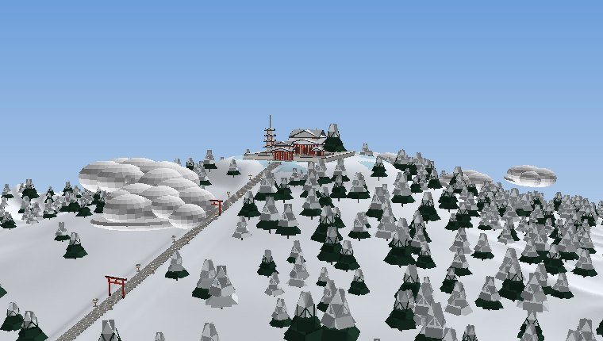 | 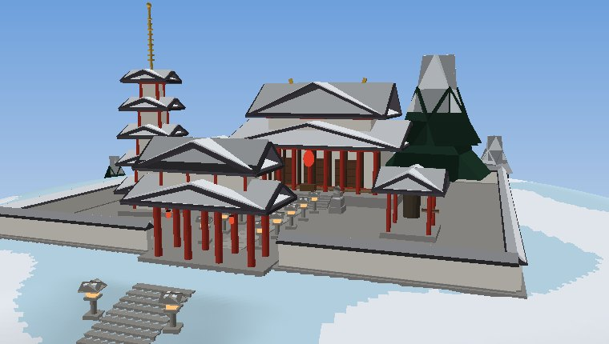 |
| 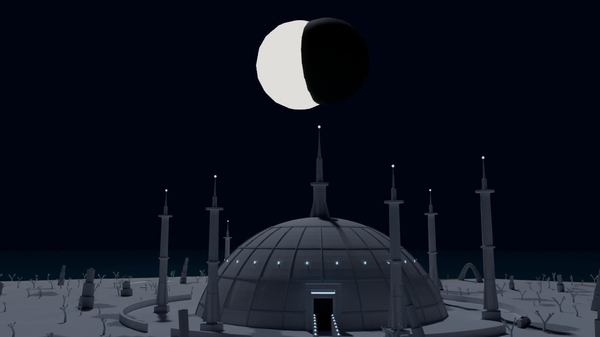 | 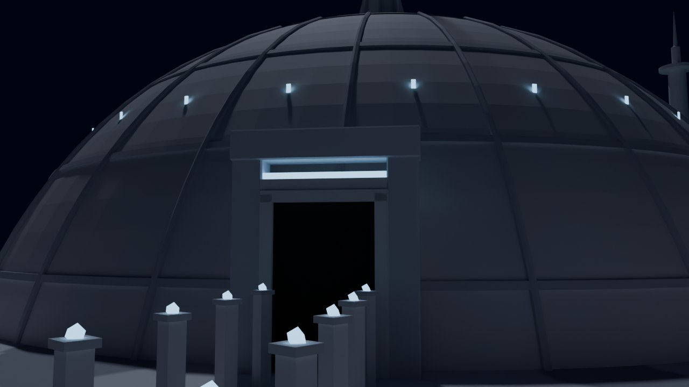 |
| 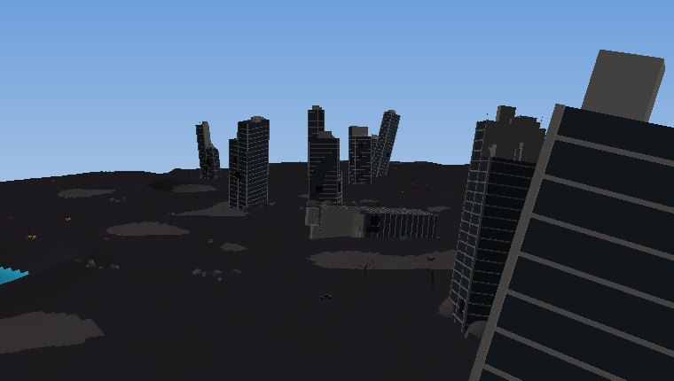 | 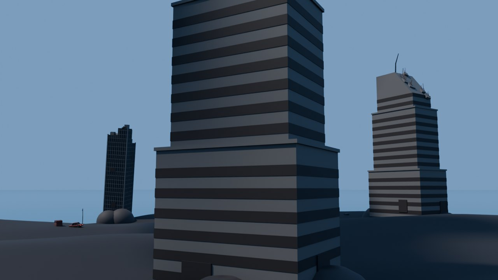 |
| 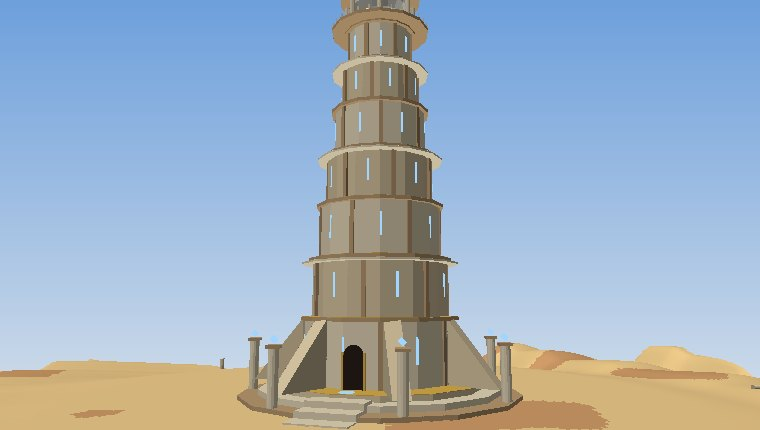 | 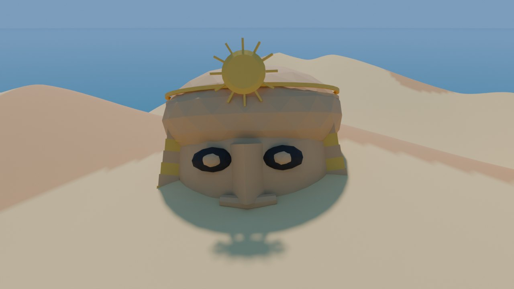 |
| 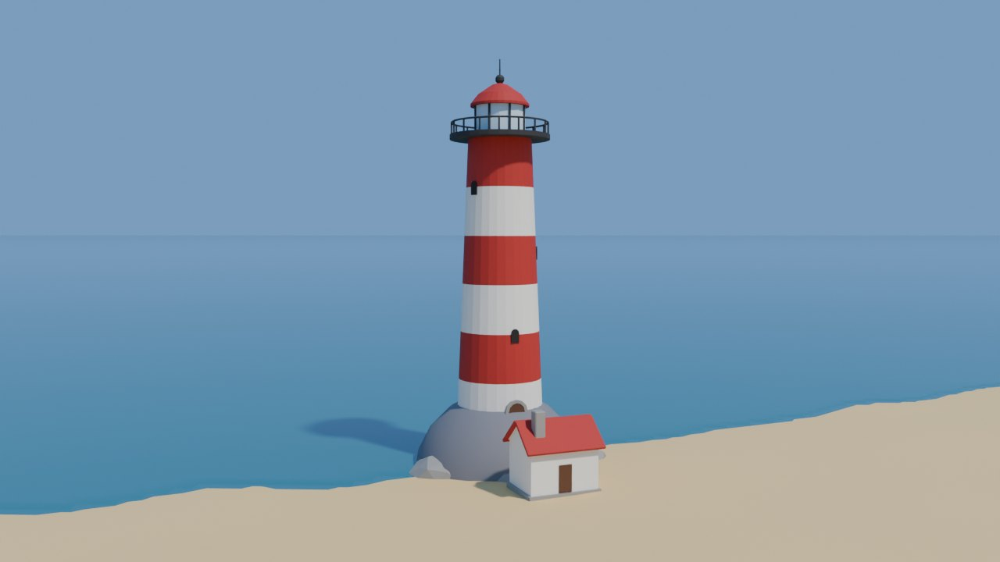 | 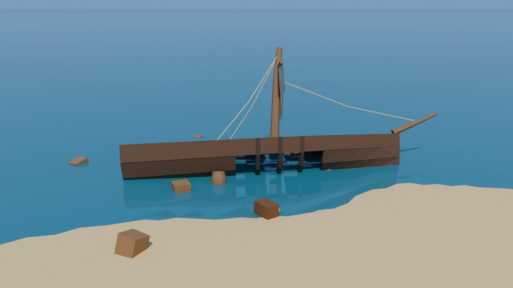 |

## The watchtower

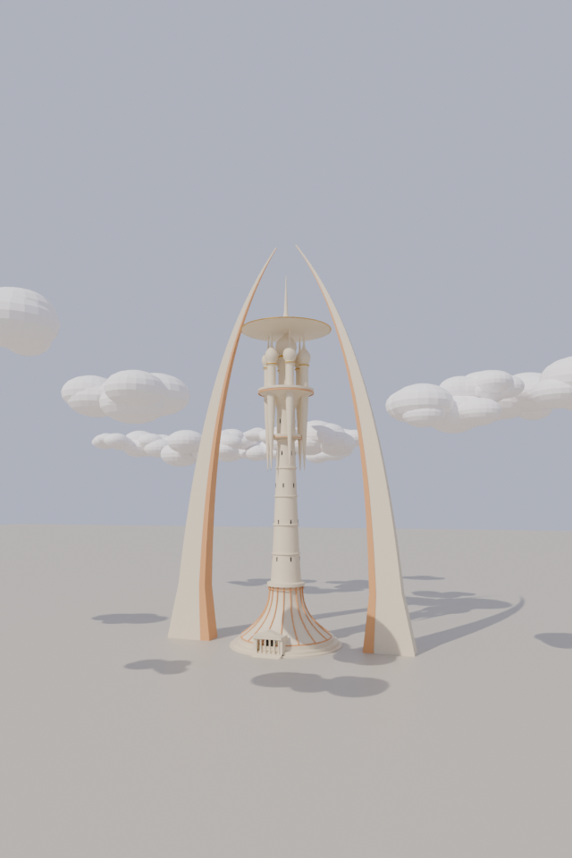

The watchtower in the dunes is modelled after the Pleiades Watchtower from
Re:Zero: a flared base with a temple entrance, a long slender shaft with a
balcony, a crown of six onion-domed pillars whose stalactite roots hang far
below, a saucer-ringed needle spire, and two colossal horn arches (with a
warm stripe along their inner edge) rising over it. 15 meshes, ~28k
triangles.

It is part of `IslandAssets.fbx`, so importing that is all you need. If you
only want the tower, you can import `assets/PleiadesWatchtower.fbx` instead
and name the model **`PleiadesWatchtower`**; the generator stands it upright,
scales it to full size (it is exported at 1/10 scale so the importer never
hits Roblox's 2048-stud mesh limit), turns the entrance toward the island
center and colours each piece by its name prefix (`Stone_`, `Trim_`, `Gold_`,
`Dark_`). Without either import, the same shape is built from parts.

To rebuild the standalone tower: `python tools/blender/pleiades_watchtower.py assets --render`.

## Settings

`IslandMapGenerator/Config` (edit the ModuleScript in ServerStorage before running):

| Setting | Default | Meaning |
| --- | --- | --- |
| `PLAYER_START` | `"Forest"` | `"Forest"` = spawn in the Wildwood arrival circle, `"Hub"` = spawn in the capital in front of the palace. Both spawn pads are built; this picks the enabled one. |
| `FOLIAGE_DENSITY` | `1` | Multiplies trees, bushes and beach decor. `1` gives about 40k parts with the meshes (125k without); `0.5` roughly halves the forests. |
| `Build` | all `true` | Turn steps on or off. |
| `STREAMING` | `true` | Enable instance streaming. |
| `CLEAR_EXISTING` | `true` | Clear old terrain and generated folders before building. |

`IslandMapGenerator/IslandLayout` holds the map shape:

- `ISLAND_RADIUS = 6000`: the island is about **12,000 studs across**, with
  sea out to a world border at ~7,400 studs from the center. Everything
  (landmarks, sea, border) scales from this one number.
- `SEED`: change it for a differently shaped island and different scatter.
- Region names and subtitles (`ZoneInfo`), the order of regions, the capital size, etc.

**About "maximum size":** Roblox has no fixed map-size limit, but physics and
rendering get jittery far from the origin, and build time and part count grow
with the island's area. 12,000 studs is already enormous (it takes a few
minutes to run across). You can raise `ISLAND_RADIUS` to about 8000 if you
want it even bigger. Expect roughly 1.8× the parts and build time, and
consider lowering `FOLIAGE_DENSITY`.

### Region atmosphere

`StarterPlayerScripts/IslandAtmosphere` has a `PROFILES` table per region
(time of day, brightness, fog colour, colour grading, clouds, weather) and an
`AMBIENT_SOUNDS` table. Paste a sound asset id per region there for ambience.

## Repository layout

```
src/IslandMapGenerator/        the generator (Rojo-compatible: default.project.json)
  init.luau                    Build() / Clear()
  Config.luau, IslandLayout.luau
  Landscape.luau               height + materials for every point of the island
  TerrainWriter.luau           writes the terrain voxels
  Waterworks.luau              fountain, pool and waterfall water
  AssetLibrary.luau            finds and places the imported IslandAssets meshes
  Props.luau                   trees, palms, lanterns, cars, bones, ...
  Watchtower.luau              the dunes watchtower (mesh or parts)
  Atmosphere.luau              lighting setup + installs the client script
  Zones/*.luau                 one builder per region
  Client/IslandAtmosphere.client.luau
dist/IslandMapGenerator.rbxmx  ready-to-insert model (built from src)
assets/IslandAssets.*          all detailed meshes (.fbx to import, .obj, editable .blend)
assets/PleiadesWatchtower.*    the watchtower on its own
tools/blender/                 Blender scripts that model and export the meshes, map renderer
tools/                         test harness (Roblox API mock), previews, rbxmx builder
docs/previews/                 preview images
```

### Developing

The generator can run outside Studio against a Roblox API mock using the
standalone [Luau](https://github.com/luau-lang/luau/releases) interpreter:

```sh
python3 tools/bundle.py tools/test_driver.luau /tmp/test.luau && luau /tmp/test.luau   # full build + stats (parts only)
python3 tools/tests/library_fixture.py assets/IslandAssets.obj > /tmp/lib.luau          # stand-in for the imported meshes
cat /tmp/lib.luau tools/test_driver.luau > /tmp/d.luau && python3 tools/bundle.py /tmp/d.luau /tmp/t.luau && luau /tmp/t.luau  # full build with meshes
cat /tmp/lib.luau tools/tests/library_driver.luau > /tmp/d.luau && python3 tools/bundle.py /tmp/d.luau /tmp/t.luau && luau /tmp/t.luau  # mesh placement test
python3 tools/preview.py ./luau docs/previews/island_map.png 360                        # top-down map
python3 tools/render.py ./luau /tmp/renders                                             # quick software previews (parts only)
python tools/blender/render_map.py ./luau /tmp/renders --library assets/IslandAssets.obj  # Blender previews with the meshes
python3 tools/build_rbxmx.py                                                            # rebuild dist/*.rbxmx
python3 tools/tests/make_import_fixture.py assets/PleiadesWatchtower.obj > /tmp/fx.luau  # standalone watchtower import test:
cat /tmp/fx.luau tools/tests/import_driver.luau > /tmp/d.luau && python3 tools/bundle.py /tmp/d.luau /tmp/t.luau && luau /tmp/t.luau
```
